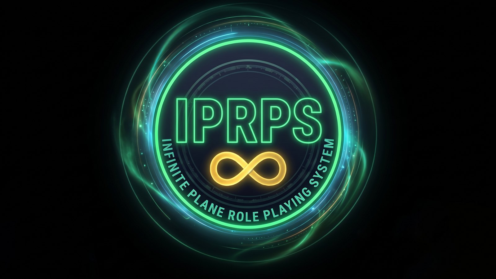
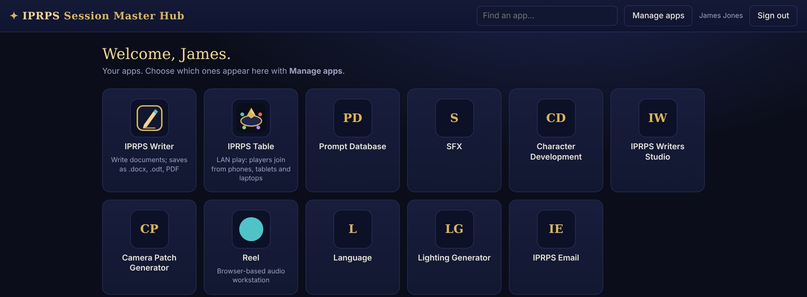
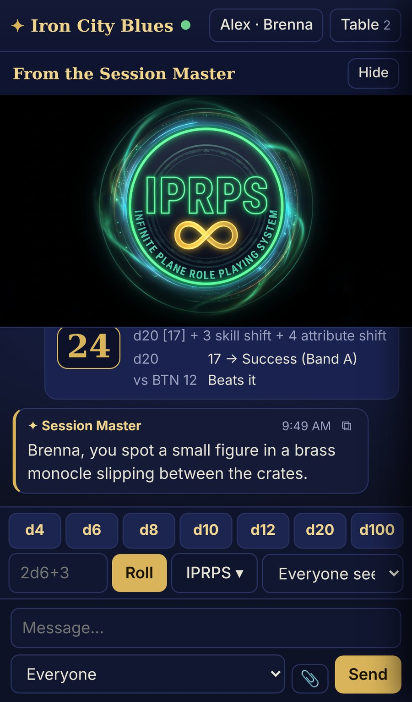
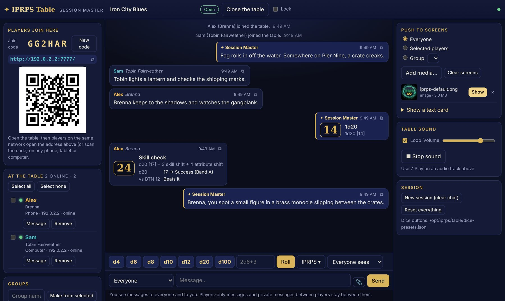
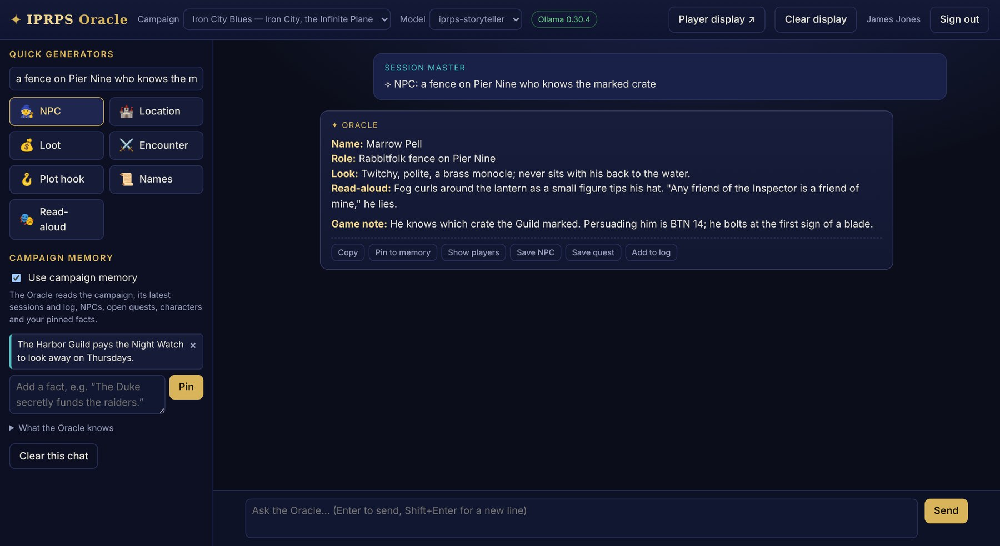
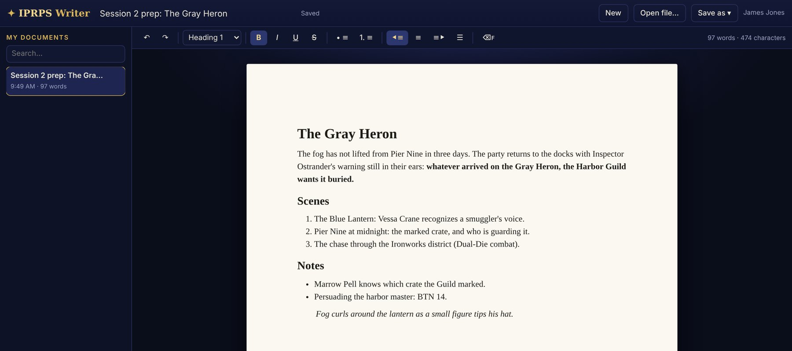
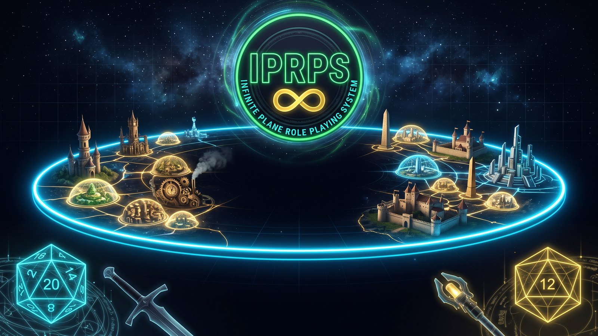

# IPRPS OS — What It Is and What It Can Do

*Reference guide for users · Updated October 29, 2026*

## What IPRPS OS is

IPRPS OS is a free, ready-to-use operating system for running and creating tabletop role-playing games, built around the Infinite Plane Role Playing System (IPRPS) by Mythical Legends Publishing. It turns an ordinary 64-bit PC into a Session Master's workstation: your campaign apps on one home page, play over the local network with your players' own phones and tablets, a player display for a second screen, music and ambience, writing, art and video tools, and (in Medium and Advanced) a storyteller AI that runs entirely on your computer.

- **Built for the table.** The desktop, menus and apps are organized around preparing and running sessions, not around office work.
- **Local-first.** Campaign data lives in a database on your own computer. The IPRPS apps run on a built-in web server that only your computer can reach, and they work without internet.
- **Players join from their own devices.** The **IPRPS Table** lets anyone on the same Wi-Fi join your campaign from a phone, tablet or laptop, so a second screen is optional.
- **Built from source.** IPRPS OS is built with Linux From Scratch and Beyond Linux From Scratch, the community books for building a Linux system from source code. It isn't a re-skin of another distribution.
- **Three editions.** Lite, Medium and Advanced, so it fits anything from an older laptop to a creative studio PC.

> IPRPS OS 1.0 is in its final testing. Lite is being released first; Medium and Advanced follow. Features marked *In development* or *Planned* below aren't available yet.

## Who it's for

IPRPS OS is for anyone who runs, writes or produces role-playing games and wants their tools in one dedicated system.

| You are | What IPRPS OS gives you |
| --- | --- |
| **Session Master** running a regular table | Session Master Mode: your campaign apps, ambience and either a player display or the IPRPS Table, opened with one click |
| **Session Master with one screen** | The IPRPS Table: players follow along, chat and roll dice on their own phones and laptops while you push maps, handouts and music to them |
| **Storyteller or worldbuilder** | IPRPS Writer, the IPRPS Oracle for NPCs and plot hooks (Medium and up), LibreOffice, and a database for NPCs, quests and handouts |
| **Content creator** (art, maps, audio, video) | Image, vector, audio and video editors, plus IPRPS production apps such as Lookbook Studio and THE DIRECTOR (Advanced) |
| **Gaming group** sharing one machine | One account per person, with each person's campaigns, documents and app choices kept separate |
| **Game club, school or library** | A low-cost, consistent setup that runs on donated or older PCs (Lite) |
| **Owner of an older PC** | The Lite edition runs on 6 GB of RAM, on computers that use legacy BIOS, and on desktops with a single display output |

## Is it right for you?

IPRPS OS is a good fit if your computer is mainly for preparing and running games, writing and creating. It's a poor fit if you depend on Windows-only software.

**A good fit if you:**

- want one dedicated machine for game nights, prep and creative work
- prefer your campaign and player data stored on your own computer
- run games in person, with a TV, projector or second monitor, or with players' phones and tablets on the same Wi-Fi
- write, draw, record or edit video for your campaigns or setting
- want AI help at the table without sending your campaign to an online service (Medium and Advanced)
- have a 64-bit Intel or AMD PC from roughly the last 10 to 12 years

**Not a good fit (yet) if you:**

- need Windows or Mac software, such as Windows-only games, Microsoft Office or Adobe apps
- need a computer that requires **Secure Boot** to stay on (common on locked-down work PCs)
- want to keep Windows on the same disk: the 1.0 installer erases the target disk, so dual boot isn't supported
- have a 32-bit-only PC or an Apple Silicon Mac (M1 or later)
- rely on NVIDIA's proprietary driver for gaming or GPU computing; NVIDIA cards run on the open-source driver with limited performance

> **Try before you commit.** IPRPS OS runs straight from a USB stick, or in a virtual machine on Windows, without changing your computer (see *Getting IPRPS OS*).

## The three editions

All three editions share the same desktop, web server, database and campaign tools. Each step up adds more apps, so pick the one that matches your computer and what you create.

|  | **Lite** | **Medium** | **Advanced** |
| --- | --- | --- | --- |
| Best for | Running games; older or modest PCs | Most Session Masters and Storytellers | Content creators and power users |
| Memory (RAM) | 6 GB minimum | 8 GB minimum, 16 GB recommended | 16 GB recommended |
| Storage | 64 GB or more | 64 GB or more | 128 GB or more |
| Campaign tools | Session Master Hub, IPRPS Table (LAN play and dice), player display, IPRPS Writer | Same, plus more IPRPS apps | All IPRPS apps |
| Local AI | — | **IPRPS Oracle** (storyteller model included) | IPRPS Oracle |
| Web browser | Firefox | Chromium (default; IPRPS apps open in their own windows) and Firefox | Same as Medium |
| Documents | IPRPS Writer (.docx, .odt, PDF), Evince (PDF), Mousepad (text) | + LibreOffice, printing | + scanning |
| Images | Ristretto (viewer), Drawing (simple painting) | + GIMP, Inkscape, ImageMagick | + FontForge, Graphviz, Krita, Blender |
| Audio | Parole (music and ambience) | + VLC | + Audacity, LMMS |
| Video | mpv | + VLC, FFmpeg | + Shotcut, Kdenlive |
| Publishing | — | — | + Scribus, Calibre, Pandoc |
| Discs | — | Xfburn (burning) | + disc mastering tools |

These RAM amounts are for smooth everyday use. **Lite runs well on 6 GB.** Medium and Advanced start on 6 GB too, but feel slow there with several large apps open (Chromium, LibreOffice, GIMP, Blender or a video editor), and the IPRPS Oracle's AI model uses several gigabytes of its own while it answers. IPRPS OS creates a swap file at first boot, which helps when memory runs short, at the cost of speed.

You can start with Lite and add software yourself later. Moving to a higher edition means a fresh install, so back up your campaign data first.

## System requirements

Any 64-bit Intel or AMD PC with 6 GB of RAM and 64 GB of storage (128 GB for Advanced) can run IPRPS OS Lite; 16 GB of RAM is recommended for Medium and Advanced.

| Item | Minimum | Recommended |
| --- | --- | --- |
| Processor | 64-bit Intel or AMD (x86-64) | 4 or more cores |
| Memory (RAM) | 6 GB (Lite), 8 GB (Medium) | 16 GB |
| Storage | 64 GB (128 GB for Advanced) | SSD, 128 GB or more |
| Firmware | UEFI or legacy BIOS | UEFI |
| Secure Boot | Must be **off** | Off |
| Graphics | Intel, AMD or NVIDIA (open-source drivers) | Intel or AMD (a Vulkan-capable GPU speeds up the Oracle) |
| Network | Wired or Wi-Fi (most common chips supported) | Wi-Fi or wired, for the IPRPS Table |
| Second screen | Optional | TV, projector or monitor for the player display; otherwise the IPRPS Table |
| Players' devices | Optional | Any phone, tablet or computer with a web browser, on the same network |
| Internet | Not needed to run games | Needed for downloads, updates and online AI apps |

> **Secure Boot** is a firmware setting. You turn it off once in the computer's setup screen (usually opened with F2, Del or F10 at power-on).

## What you can do

IPRPS OS covers the whole cycle of a campaign: prepare it, run it at the table, track what happened, and turn it into something you can publish or share.

### Run sessions

- **Session Master Mode** opens the Session Master Hub, starts your ambience playlist and, with a second monitor or projector, puts a full-screen **player display** there. On a computer with **one screen**, it opens the **IPRPS Table** instead.
- **The Session Master Hub** is your home page: the campaign apps you use as tiles. **Manage apps** lists every IPRPS app on the computer with an on/off switch, and each Session Master keeps their own choice.
- **The player display** shows players only what you reveal on the second screen.

### Play over the local network: the IPRPS Table

Open the table and your players join from their own devices: they open the address shown in your console, or scan its QR code, and type the join code. No app to install, and no internet needed.

**Players can:**

- chat with everyone, with the other players only, privately with the Session Master, or privately with another player, attaching images (pasting works) and audio files
- see whatever the Session Master pushes to them: maps, handouts, video clips and text cards, at the top of their screen
- hear music and sound effects the Session Master plays on their device
- roll from a dice toolbar: d4 to d100, any expression such as `2d6+3`, and the **IPRPS rolls**: skill checks with their success bands and BTN, initiative, reaction, Trinity and Hydra Hand, Dual-Die attacks, Infinite Convergence with exploding dice, RPS stances and weapon damage, each visible to everyone, only the Session Master, or only the roller

**The Session Master can:**

- see who has joined, whether they're online, and what device they're on
- make groups of players for a split party
- message everyone, a group, selected players or one player
- push images, video and text, and play sound, to everyone, a group or selected players
- roll in secret, copy any message or roll, and remove a player or lock the table

Every roll is made on the Session Master's computer, so nobody can fake one. The Session Master doesn't see players-only or player-to-player private messages.

### Get help from the IPRPS Oracle (Medium and Advanced)

The **IPRPS Oracle** is a storyteller AI for Session Masters that runs **entirely on your computer**: no internet, no account, no API key, and nothing leaves the machine.

- **Ask anything** about your scene, or use the quick buttons: NPC, location, loot, encounter, plot hook, names, and read-aloud descriptions.
- **It knows your campaign.** It reads your campaign's NPCs, quests and session log, plus facts you pin, and you can save what it creates straight back into the campaign.
- **Show players** sends a description to the player display.

### Track campaigns and players

The built-in campaign database records:

- campaigns, players and their characters, including level, XP and full character sheets
- each session: date, recap, Session Master notes, who attended and the XP awarded
- NPCs, quests and their status, and handouts with what's been revealed
- a timeline of notes, rolls, combat, loot and XP for every session

The Hub's screens for entering and browsing these records are in development (see the status table below).

### Create

- **Write:** IPRPS Writer for session notes and lore (opens and saves Word and OpenDocument files, and prints to PDF), Mousepad for quick notes, LibreOffice for rulebooks (Medium and up), and the IPRPS Writing Assistant (Medium and up).
- **Draw and map:** Drawing for quick sketches (Lite), GIMP for images and Inkscape for maps and character sheet layouts (Medium and up), Krita for painting and Blender for 3D (Advanced).
- **Sound:** Parole for music and ambience, Audacity for narration and effects, LMMS for soundtracks (Advanced).
- **Video:** mpv and VLC for playback, Shotcut and Kdenlive for trailers and session recaps (Advanced).
- **Publish:** Scribus for print layout, Calibre for e-books, Pandoc for converting documents (Advanced).
- **Print:** character sheets, handouts and maps, with CUPS printer support (Medium and up).

### Status of the IPRPS tools in version 1.0

| Tool | What it does | Status |
| --- | --- | --- |
| Session Master Hub | Home page with your apps; Manage apps per account | Included |
| IPRPS Table | Play over the local network: chat, IPRPS dice, pushed images, video and sound | Included |
| IPRPS Writer | Word processor; .docx, .odt, .txt, .html and PDF | Included |
| Player display | Full-screen view for players on a second screen | Included (shows what the Oracle sends; maps and initiative to come) |
| IPRPS Oracle | Local storyteller AI with campaign memory | Included (Medium and up) |
| Campaign database | Stores campaigns, characters, sessions, NPCs, quests | Included |
| Universal Login | One sign-in for all local IPRPS apps | Included |
| Campaign screens in the Hub | Campaigns, players, characters, sessions, NPCs, quests | In development |
| Initiative and combat tracker | Turn order, hit points, conditions | In development |
| Session log and recap | Timeline of each session; exportable recaps | In development |
| IPRPS Media Player | Music, ambience, CDs, DVDs and IPRPS radio | Included (Medium and up) |
| Genesis Character Engine | AI character reference sheets | Included (Medium and up; needs internet and your API key) |
| IPRPS Writing Assistant | AI-assisted writing for lore and prep | Included (Medium and up; needs internet and your API key) |
| Soundboard | One-click effects and ambience during play | Planned |
| IPRPS File Viewer | Opens and checks .iprps, .ipai, .srpatch and .capstone files | Planned |
| IPRPS Welcome | First-run tour, settings and API keys | Planned |

## The IPRPS Desktop and Session Master Mode

The IPRPS Desktop is a customized Xfce desktop: light enough for 6 GB machines, with everything for play one click away.

- **IPRPS menu:** every IPRPS app in one category of the applications menu. In Medium and Advanced each IPRPS app opens in its own window, like a desktop program.
- **Panel:** launchers for Session Master Mode and the Hub, plus volume, network and battery indicators.
- **Wi-Fi:** a simple Wi-Fi window lists nearby networks and connects with a password; the network icon handles the rest.
- **Look:** IPRPS branding on the boot menu, login screen and wallpaper, with a dark theme and the IPRPS icon set.
- **Your folders:** each user gets a *Campaigns* folder with *Handouts*, *Maps* and *Audio* inside, ready for session material.

**Session Master Mode** is the heart of game night. One click:

1. opens the **Session Master Hub**
2. plays your *Campaigns/Audio* folder as shuffled, looping **ambience**, in a small window with play, pause and volume controls
3. with a **second screen**, opens the **player display** full screen there; with **one screen**, opens the **IPRPS Table** console so players can join from their own devices
4. in Medium and Advanced, warms up the **IPRPS Oracle** so its first answer comes quickly

You run the game from the Hub on your screen; players see only what you share.

## Getting IPRPS OS

Each edition is one compressed disk image. Write it to a USB stick, boot from it, and IPRPS OS is ready; installing to the computer's internal disk is optional.

**Download:** **infiniteplane.space/downloads/iprps/1.0**. The source code, build guide and release notes are on GitHub at **github.com/chiitascaran-collab/iprps-linux-distro**.

| File | Use it for |
| --- | --- |
| `iprps-os-1.0-<edition>.img.xz` | A USB stick or an internal disk; boots on UEFI and BIOS computers |
| `iprps-os-1.0-<edition>.vhdx` | Trying it in Hyper-V on Windows |
| `iprps-os-1.0-<edition>.qcow2` | Trying it in QEMU, virt-manager or Proxmox |
| `SHA256SUMS-<edition>` | Checking that your download is complete and unaltered |

**From download to desktop:**

1. Check the download against `SHA256SUMS`.
2. Write the `.img.xz` to a USB stick with **Rufus** or **balenaEtcher**. Everything on the stick is erased. To run IPRPS OS from the stick day to day, use one of 64 GB or more; the system grows to fill it.
3. Turn off **Secure Boot** in the computer's firmware settings.
4. Boot from the stick, using the computer's one-time boot menu (often F12, F11, F8 or Esc).
5. **First boot:** IPRPS OS expands to fill the stick, creates swap space, and asks for your user name, full name, password, computer name and time zone.
6. Log in. You're at the IPRPS Desktop.

**To install on the computer itself:** run *Install IPRPS OS to This Computer* from the IPRPS menu, choose the internal disk, and confirm. That disk is **completely erased**, so back up anything you need first.

**To try it without touching your PC:** use the `.vhdx` in Hyper-V (Generation 2, Secure Boot off) or the `.qcow2` in QEMU.

## Your data and privacy

Your campaigns, players and session records stay on your computer. Nothing is sent anywhere unless you use an online feature.

- **Local web server.** The IPRPS apps run on a web server (Apache with PHP) that accepts connections **only from the computer itself**.
- **The IPRPS Table** is the one part that other devices can reach, and only while you have a table **open**, only on your local network, and only with the join code. Its console opens only on your computer. Closing the table disconnects everyone; after a restart the table is always closed.
- **Local database.** Campaign data lives in a MariaDB database with no network port at all. Each installation gets its own randomly generated database password on first boot.
- **Local AI.** The IPRPS Oracle runs on your computer and listens only to it. Your campaign never leaves the machine.
- **Your accounts.** Each person who uses the computer gets their own account, files and settings. The first user can administer the system with their own password; the root account is locked.
- **Online AI apps are opt-in.** The Genesis Character Engine and the Writing Assistant send your prompts to an online AI service using **your own API key**. No keys ship with IPRPS OS. Without a key and internet, those two apps don't work; everything else does.
- **No telemetry.** Nothing reports home. Firefox and Chromium ship with tracking, studies and promotions switched off.
- **Player data.** If you store players' real names or contact details, you're responsible for keeping them safe. Back up your *Campaigns* folder and the campaign database regularly.

## Updates, customization and open source

**Updates.** In version 1.x, updates arrive as new edition images (1.0.1, 1.0.2, and so on) with release notes listing security fixes. To update, back up your *Campaigns* folder and database, then install the new image. A package manager for in-place updates is planned (see *Future expansion*).

**Make it yours.** IPRPS OS ships ready to use, but nothing is locked down:

- the first user has `sudo` for full administrator access
- compilers and build tools are included, so you can add any software from source, following the Beyond Linux From Scratch book
- drivers for nearly all hardware are included as loadable modules, and you can rebuild the kernel for your exact machine
- the desktop's theme, panel and menus are standard Xfce settings you can change
- the IPRPS Table's dice buttons are a settings file you can edit, and **Manage apps** chooses what the Hub shows

**Open source.** IPRPS OS is built from open-source software. For each release, the complete source code of its open-source components is published, as their licenses require. A few choices keep the system legally redistributable:

- **Firefox** is built without Mozilla's official branding, so it carries a generic name and icon; it's the same browser. **Chromium** is the open-source, ungoogled build.
- **Media formats.** FFmpeg is built without its non-free options, and some patent-encumbered hardware video acceleration is turned off. Common formats still play; users who need more can add it themselves where it's legal.
- **Firmware.** Hardware firmware comes from the official linux-firmware collection, with its license texts included.
- **The Oracle's model** is an openly licensed (Apache-2.0) language model with IPRPS instructions on top.

IPRPS apps are by Mythical Legends Publishing; each app states its own license. IPRPS OS's own system scripts, configuration, apps it adds (the Hub, the IPRPS Table, IPRPS Writer, the IPRPS Oracle) and build guide are free software under the GNU General Public License, version 2.

## Future expansion

These are plans, not promises, and dates aren't set; each release's notes say what actually shipped.

1. **Version 1.0:** the three editions, Session Master Mode, the Hub, the IPRPS Table, IPRPS Writer, the campaign database and, in Medium and Advanced, the IPRPS Oracle.
2. **Campaign tools in the Hub:** campaign, character, session, NPC and quest screens, the initiative and combat tracker, and the session log, all feeding the player display and the IPRPS Table.
3. **Version 1.1: Live ISO.** A try-before-you-install image that boots read-only from USB or DVD and installs from there.
4. **More IPRPS apps:** Soundboard, IPRPS File Viewer for `.iprps`, `.ipai`, `.srpatch` and `.capstone` files, and the IPRPS Welcome app with a protected place for API keys.
5. **A custom-trained IPRPS model** for the Oracle, which can replace the bundled one without changing the app.
6. **Package manager:** install and update software, and apply security updates, without reinstalling the whole system.

Follow infiniteplane.space and the GitHub repository for announcements.

## Frequently asked questions

**Is IPRPS OS free?** Yes, the operating system is free to download and use. IPRPS apps state their own licenses.

**Do I need to know Linux?** No. First-boot setup, the desktop and the IPRPS apps are point-and-click. Linux knowledge helps only if you want to customize the system deeply.

**Can my players use their own phones or laptops?** Yes, with the IPRPS Table. Players on the same network open the address or scan the QR code shown in your console, enter the join code, and they're at the table: chat, dice, and anything you push to them. They don't need IPRPS OS, an app or an account; any web browser works.

**I only have one monitor. Can I still run a game?** Yes. Session Master Mode opens the IPRPS Table instead of a player display when there's one screen, and your players follow on their own devices.

**Does it need the internet?** No, not for running games. The Hub, the IPRPS Table, IPRPS Writer and the IPRPS Oracle all work offline. You need internet to download IPRPS OS, for updates, and for the online AI apps (Genesis Character Engine, Writing Assistant).

**How is the IPRPS Oracle different from the online AI apps?** The Oracle runs on your computer, needs no account or key, and keeps your campaign private. The online apps use a larger AI service over the internet with your own API key.

**Can I keep Windows on the same computer?** Not with the 1.0 installer, which erases the target disk. You can run IPRPS OS from a USB stick instead, install it on a second disk, or try it in a virtual machine on Windows.

**Can I play my Windows games on it?** No. IPRPS OS is built for running and creating tabletop RPGs, not for Windows games.

**Will my Wi-Fi, sound and graphics work?** On most Intel and AMD computers, yes: drivers and firmware for common hardware are included. A few Broadcom Wi-Fi chips aren't supported. NVIDIA graphics use the open-source driver, which works for the desktop but has limited 3D performance. If the screen stays black, choose *IPRPS OS (safe graphics)* in the boot menu.

**Can several people use one computer?** Yes. Each person gets their own account with separate files, documents and Hub choices.

**How do I get updates?** Through new edition images in 1.x; back up your *Campaigns* folder and database, then install the new image. In-place updates arrive with the planned package manager.

**Where's the source code?** On GitHub, at github.com/chiitascaran-collab/iprps-linux-distro, with the complete build guide.

## Glossary

| Term | Meaning |
| --- | --- |
| **IPRPS** | Infinite Plane Role Playing System, the tabletop RPG system by Mythical Legends Publishing |
| **Session Master** | The person who runs a game session (often called a game master) |
| **Storyteller** | A writer or worldbuilder who creates campaigns, lore and settings |
| **Edition** | One of the three versions of IPRPS OS: Lite, Medium or Advanced |
| **Session Master Mode** | One-click setup for game night: the Hub, ambience, and the player display or the IPRPS Table |
| **Session Master Hub** | The home page of the Session Master's apps |
| **IPRPS Table** | Play over the local network: players join from their own devices to chat, roll dice and see what the Session Master shares |
| **Join code** | The six-character code players type to join an open IPRPS Table |
| **IPRPS Oracle** | The storyteller AI that runs on your computer (Medium and Advanced) |
| **Player display** | A full-screen window for players on a second screen, showing what the Session Master reveals |
| **BTN and AR** | Base Target Number and Armor Rating, the IPRPS targets for rolls and damage |
| **Disk image** | A single file containing a complete, bootable copy of the system, written to a USB stick or disk |
| **Secure Boot** | A firmware setting that only allows signed systems to start; it must be off for IPRPS OS |
| **Firmware** | Small programs some hardware (Wi-Fi, graphics) loads to work |
| **sudo** | The command that lets an authorized user run administrator tasks |
| **Linux From Scratch (LFS)** | The book IPRPS OS's base system is built from, compiled entirely from source code |
| **.iprps, .ipai, .srpatch, .capstone** | IPRPS file formats for characters, AI profiles, session run patches and capstones |
