# IPRPS OS Session Master Training Manual

*Learn to prepare, run and wrap up great games with IPRPS OS · Version 1.0 · November 2026*

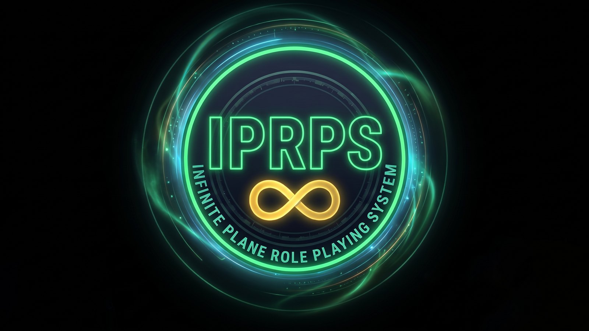

## How to use this manual

This manual teaches you to run games with IPRPS OS. You will learn the tools one at a time. Each chapter ends with a **walkthrough**: a short exercise you do on your own computer, step by step.

All the examples use one campaign, **Iron City Blues**. It is a noir mystery on the Infinite Plane, with rain, gas lamps and a harbor full of secrets. Four players are at the table:

| Player | Character | Who they are |
| --- | --- | --- |
| Dana | Brenna Holt | Wolffolk tracker who used to work for the Night Watch |
| Marcus | Tobin Fairweather | Human insurance investigator |
| Priya | Mira Quickstep | Catfolk cat burglar |
| Leo | Dr. Oro Kessel | Gemp harbor doctor |

If you have run the walkthrough adventure *Fog on Pier Nine*, you already know these people. That's fine if you haven't.

**How to read the steps:**

- Words in **bold** are buttons, menus or labels you will see on the screen.
- An arrow (→) means "then choose". **IPRPS → IPRPS Welcome** means: open the IPRPS menu, then choose IPRPS Welcome.
- Boxes that start with **Try it** are short practice tasks.
- Boxes that start with **Tip** share a shortcut or a good habit.

**What you need:** a computer running IPRPS OS (any edition), and a Wi-Fi network. For the Table chapters, borrow one or two phones, or use a tablet or laptop. The IPRPS Oracle chapter needs the Medium or Advanced edition.

| Chapter | You will learn to | Time |
| --- | --- | --- |
| 1. What makes IPRPS OS different | Know when IPRPS OS is the right tool | 10 minutes |
| 2. Get set up | Create your campaign and choose your apps | 15 minutes |
| 3. Prepare a session | Collect characters, notes, pictures and sound | 20 minutes |
| 4. Open the IPRPS Table | Get players connected on their phones | 15 minutes |
| 5. Roll the IPRPS way | Read checks, bands and BTN | 15 minutes |
| 6. Run a fight | Track initiative, HP, AR and conditions | 20 minutes |
| 7. Set the mood | Use the Soundboard and the Table's sound | 10 minutes |
| 8. Ask the IPRPS Oracle | Improvise NPCs and scenes with private AI | 15 minutes |
| 9. Wrap up the night | Write the recap and track XP | 10 minutes |
| 10. Keep it running | Install updates and invite remote players | 10 minutes |

## Chapter 1: What makes IPRPS OS different

Most digital tools for tabletop games are **websites**. You and your players sign in, and the game lives on the company's computers. IPRPS OS is different. It is a **whole computer system** made for the Session Master. It runs on your own PC, and your game lives there too.

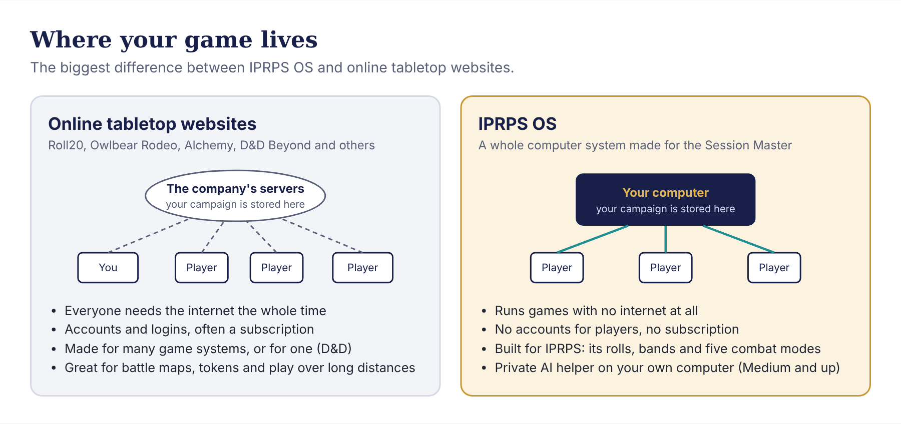

### Five things that set IPRPS OS apart

**1. It works with no internet at all.** Your players join from their own phones, tablets or laptops over your home Wi-Fi. They don't need an account, an app or a password. They scan a QR code, type a six-letter join code, and they are in. If the internet goes down on game night, nothing stops.

**2. It speaks IPRPS.** Other tools are made for many game systems, or for one other system. IPRPS OS is made for the Infinite Plane Role Playing System. The dice know the **success bands**, the **BTN** (Base Target Number), **Skill Shift** and **Attribute Shift**. The combat tracker subtracts **AR** (Armor Rating) from damage and supports all **five IPRPS combat modes**. The Character Creator counts **Development Points** for you.

**3. It has a private AI helper.** In the Medium and Advanced editions, the **IPRPS Oracle** runs on your own computer. It can invent an NPC, a place or a read-aloud description for you. It reads your campaign, so its ideas fit your story. Its own model keeps everything on your computer, with no account or fee. If you want faster answers, you can switch it to Claude, an online AI, with your own key.

**4. Every tool is connected.** The dice roller and the combat tracker write into the **session log** as you play. After the game, the log turns into a **recap** with one click. Character sheets you import show up in the combat tracker, the Table and the Oracle. One click on **Session Master Mode** opens everything you need for game night.

**5. Your game is yours.** Your campaigns, notes, sheets and recordings stay on your computer. There is no subscription to keep paying, and no company can close your account or lose your campaign.

### How it compares with popular online tools

Here is a short, fair comparison with five well-known tools. These tools are good at many things, and many groups use them happily. The details below are a summary as of November 2026; check each website for current features and prices.

| Tool | What it is | What it does best | How it differs from IPRPS OS |
| --- | --- | --- | --- |
| **Roll20** | A virtual tabletop website for many game systems | Battle maps and tokens, character sheets for many systems, a big store of official adventures, voice and video chat | Runs on Roll20's servers and needs the internet. Some features, like dynamic lighting and more storage, need a paid subscription |
| **Owlbear Rodeo** | A simple map-and-token website | Quick, clean battle maps with very little setup, plus add-on extensions | Online only. Focused on maps, so rules, notes and campaign records happen somewhere else. Paid plans add storage |
| **Alchemy RPG** | A "cinematic" virtual tabletop website | Mood: animated scenes, music and a story-first, theater-of-mind feel | Online only, with free and paid plans. Built for other publishers' games, not for IPRPS rolls |
| **Fantasy Grounds** | A desktop program for many game systems | Deep rules automation for supported systems, and a large content library | The base program is free, but most official content is sold. It is a program on top of your computer, not a whole system with prep, writing and AI tools |
| **D&D Beyond** | The official online toolset for *Dungeons & Dragons* | D&D character building, rules lookup and its own maps tool | Made only for D&D, and needs an account and the internet. Custom maps need a paid tier |

**When another tool is a better fit.** IPRPS OS 1.0 doesn't have battle maps with movable tokens, fog of war, or built-in voice and video chat. If your group plays mostly online, every week, with a battle grid, a website tool may suit you better for that part. You can still use one: open it in the web browser on IPRPS OS, and keep using the IPRPS tools for dice, combat, notes and recaps.

**When IPRPS OS shines.** IPRPS OS is at its best when your group meets **in person**, with phones and tablets around the table. It is also the best fit when you play **IPRPS**, when the internet is slow or missing, and when you want your campaign kept **private**.

> **Tip:** A player in another city can still join your IPRPS Table. Chapter 10 shows how.

## Chapter 2: Get set up

### Your first login

The first time you log in, **IPRPS Welcome** opens. It is a short tour that takes about five minutes. You can skip any step and come back later from **IPRPS → IPRPS Welcome**.

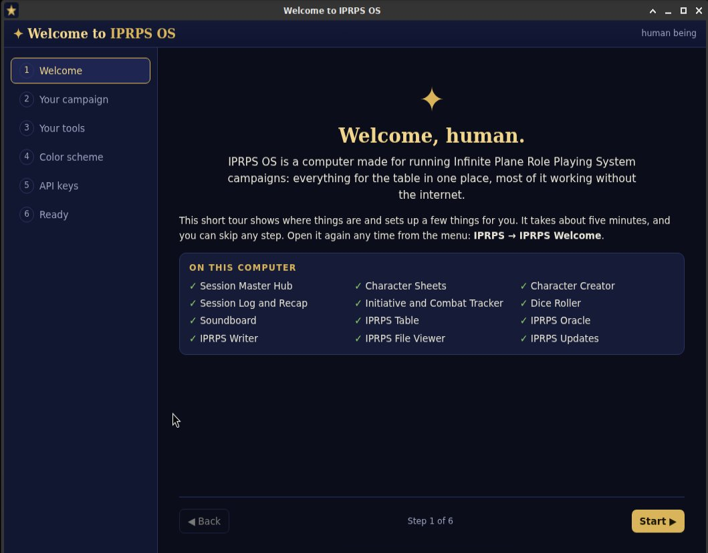

The tour has five parts:

1. **On this computer:** which edition you have and which IPRPS apps are installed.
2. **Your campaign:** create your first campaign.
3. **Your tools:** every IPRPS app, with a short description and an **Open** button.
4. **Color scheme:** how the session tools look. Choose **Night**, **Parchment**, **Forest** or **High contrast**.
5. **API keys for online AI apps:** only needed for the two online AI apps. The offline tools never need keys.

### Campaigns hold everything

A **campaign** is the folder for your whole story. Sessions, the session log, fights, character sheets, NPCs and quests all belong to a campaign. The Oracle reads it too. So create your campaign first.

### The Session Master Hub

The **Session Master Hub** is your home page. Each tile opens an app. Open it from the panel at the top of the screen or from the **IPRPS** menu. The first time, it asks you to sign in. That one sign-in covers every IPRPS app on the computer.

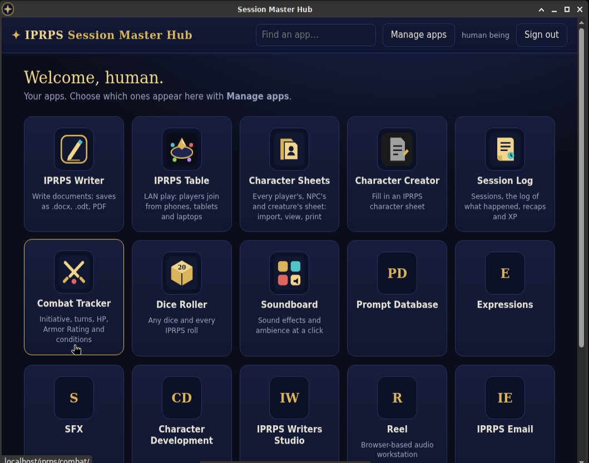

You decide which tiles appear. Choose **Manage apps**, switch apps on or off, and choose **Save**. Each Session Master on the computer keeps their own choice. **Reset to defaults** brings back the standard set.

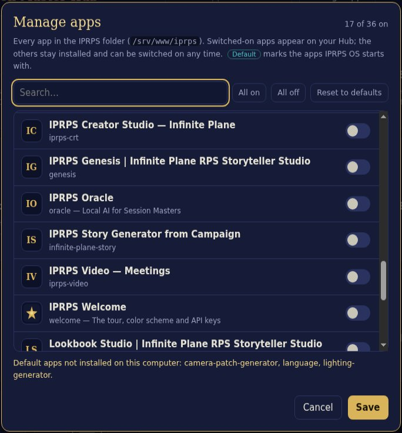

> **Walkthrough 1: Set up Iron City Blues**
>
> 1. Open **IPRPS → IPRPS Welcome** and go to the **Your campaign** step.
> 2. Type the **Name**: *Iron City Blues*. Type the **Setting**: *Iron City, the Infinite Plane*. Under **What it's about**, type one sentence: *A noir mystery in a rain-soaked harbor where the Guild rules the docks.*
> 3. Choose **Create campaign**.
> 4. Go to the **Color scheme** step and pick the one that's easiest for you to read.
> 5. Choose **Open the Session Master Hub**.
> 6. Choose **Manage apps**. Make sure these are on: IPRPS Table, Character Sheets, Character Creator, Combat Tracker, Dice Roller, Session Log, Soundboard and IPRPS Writer. Choose **Save**.
>
> **Check:** the Hub shows your apps as tiles. In the Combat Tracker, the **Campaign** menu at the top now lists *Iron City Blues*.

> **Tip:** You can add more campaigns later from any session tool. Open the **Campaign** menu at the top and choose **+ New campaign…**, or choose the **✎** button next to it to edit one.

## Chapter 3: Prepare a session

Good prep makes game night smooth. IPRPS OS gives you a place for each kind of material.

### Your campaign folders

Your home folder has a **Campaigns** folder with three folders inside it:

| Folder | Put this inside | Used by |
| --- | --- | --- |
| **Campaigns/Handouts** | Letters, clues, portraits of NPCs | The IPRPS Table (**Add media…**) |
| **Campaigns/Maps** | Maps of cities, buildings and dungeons | The IPRPS Table and the player display |
| **Campaigns/Audio** | Music and background sound (MP3, OGG, WAV, M4A) | Session Master Mode plays it as looping ambience |

Use pictures and sounds that you made yourself, or that you have the right to use.

### Notes in IPRPS Writer

**IPRPS Writer** is a word processor. Use it for scene notes, NPC lists and read-aloud text. It saves by itself as you type. **Save as** makes a Word file (.docx), an OpenDocument file (.odt), plain text or a web page. **Ctrl+P** prints, or saves a PDF.

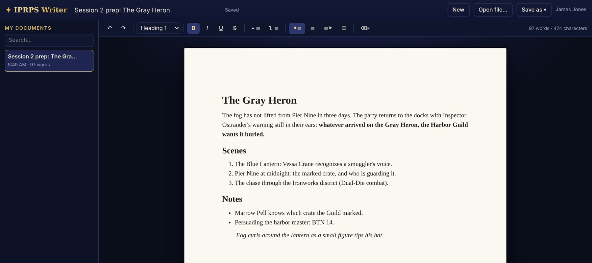

### Character sheets

IPRPS OS has two character sheet apps that work together:

- **Character Creator** is the IPRPS character sheet. It tracks attributes, skills, advantages, spells and a portrait. It also counts the **Development Points** you spend, so players can't overspend by mistake.
- **Character Sheets** is your library. It keeps every player character, NPC and creature, sorted by campaign.

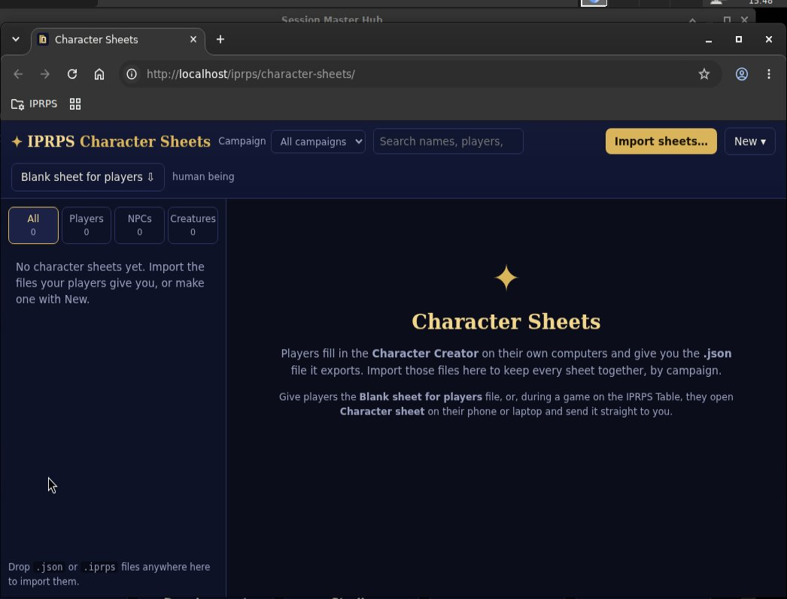

There are two ways to get your players' characters:

1. **Before the game.** In Character Sheets, choose **Blank sheet for players**. This saves the Character Creator as one file. Give it to your players by USB stick, email or a shared folder. They open it in any web browser, make their character, and send you the `.json` file it saves. You choose **Import sheets…**, or simply drop the files onto the Character Sheets window.
2. **At the table.** Players open **📜 Sheet** on their phone or laptop in the IPRPS Table and fill it in there. When they send it, it appears in your Table console under **📜 Character sheets**, and you choose **Import to Character Sheets**.

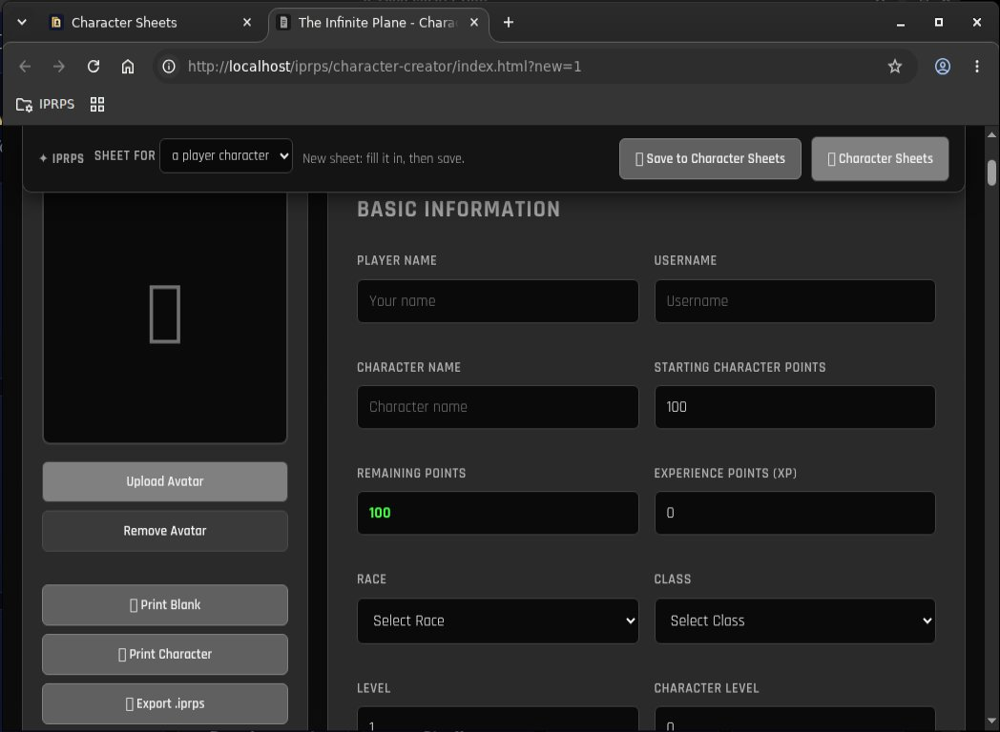

> **Walkthrough 2: Get the characters in**
>
> 1. Open **Character Sheets** from the Hub. Set **Campaign** to *Iron City Blues*.
> 2. Choose **Blank sheet for players** and save the file. Open it yourself to see what players will see.
> 3. In the file, make Brenna Holt: Wolffolk, STR 14, DEX 12, CON 14, WIS 14, and the skills Tracking 30, Brawling 20 and Intimidation 20. Watch the Development Points change as you go. Save it as a `.json` file.
> 4. Back in Character Sheets, drop the `.json` file onto the window, or choose **Import sheets…**. Choose **Import**.
> 5. Now make an NPC: choose **New ▾ → NPC sheet** and create *Inspector Hale Ostrander*, a gruff Wolffolk detective.
>
> **Check:** the list shows Brenna under **Players** and Ostrander under **NPCs**. Both will show up in the Combat Tracker's **From sheets** list.

## Chapter 4: Open the IPRPS Table

The **IPRPS Table** is the heart of in-person play. Your players join from their own devices. They can chat, roll IPRPS dice, see pictures and hear sound you send, and fill in their character sheets. You control everything from the **console** on your computer.

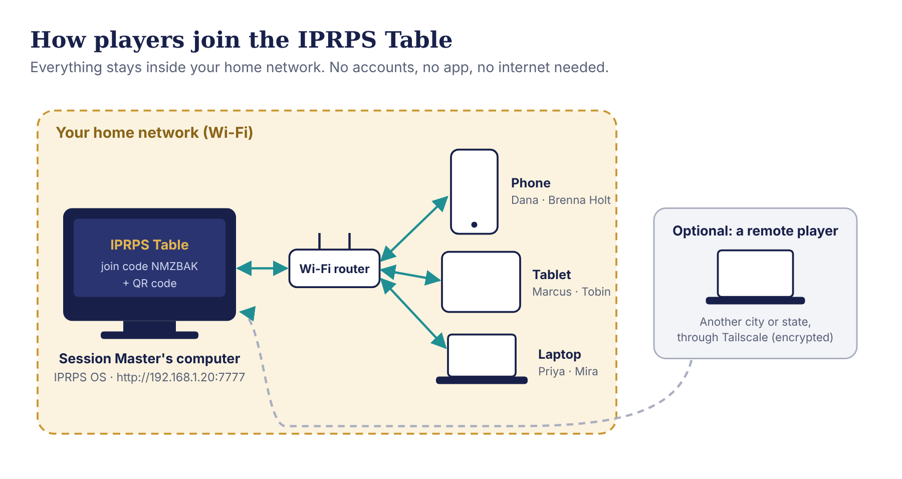

### Session Master Mode: game night in one click

About fifteen minutes before players arrive, choose **Session Master Mode** on the panel. With one click, it:

1. opens the **Session Master Hub**;
2. plays your **Campaigns/Audio** folder as shuffled, looping background sound, in a small window with play, pause and volume buttons;
3. with a **second screen** (TV, projector or monitor), opens the full-screen **player display** there; with **one screen**, it opens the **IPRPS Table** console instead;
4. in Medium and Advanced, warms up the **IPRPS Oracle**, so its first answer comes quickly.

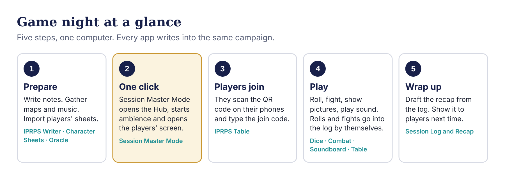

### Opening the table

The table starts **Closed**. Nobody can join until you open it.

1. In the console, click the name at the top and type the campaign name. Players see it.
2. Choose **Open the table**. The status changes to **Open**.
3. The **Players join here** box shows the **join code**, the computer's address and a **QR code**.

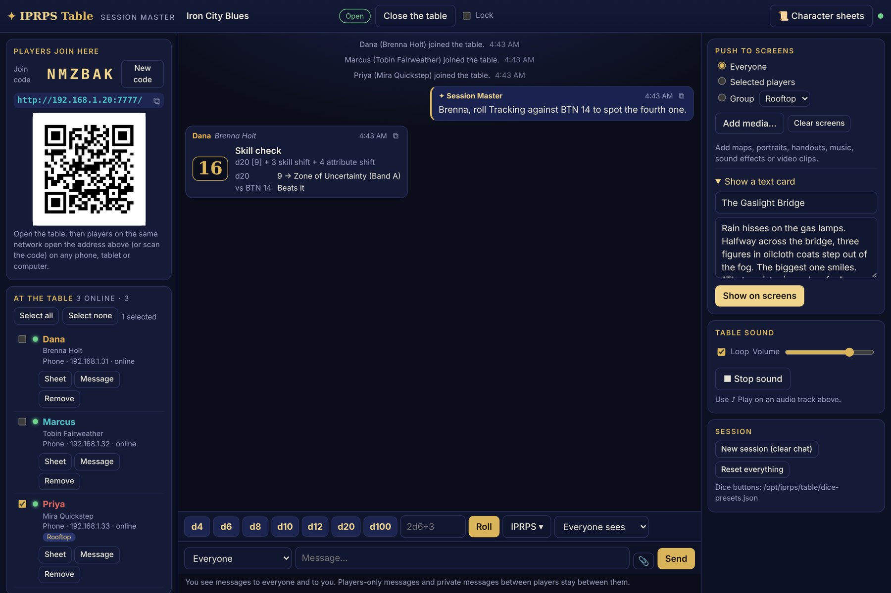

### How players join

Each player, on a device connected to the **same Wi-Fi**:

1. scans the QR code with the camera (this fills in the code), or opens the address in any web browser;
2. types their name and, if they like, their character's name;
3. taps **Join the table**.

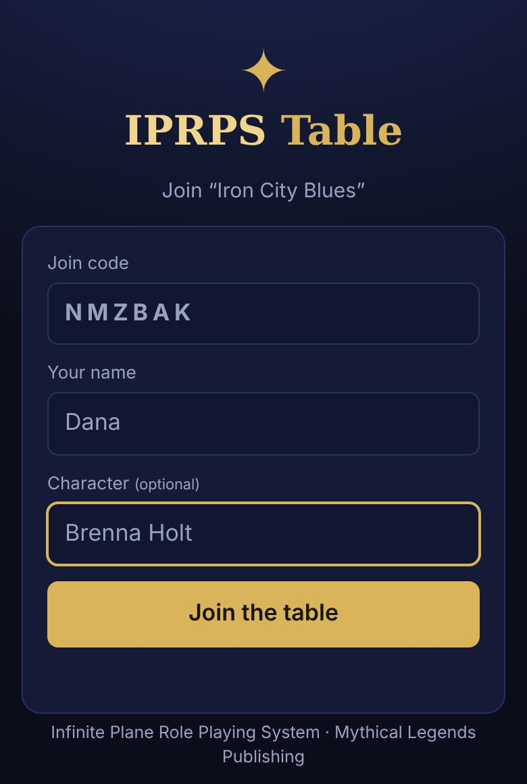

Each player appears under **At the table** with a green dot when they are online. When everyone is in, tick **Lock** so nobody else can join.

### What you can do from the console

| You want to | Do this |
| --- | --- |
| Talk to everyone | Type in the message box with **Everyone** selected, then **Send** |
| Whisper to one player | Choose their name in the **To** menu, or choose **Message** under their name |
| Talk to part of the party | Tick the players, type a name under **Groups**, choose **Make from selected** |
| Show a picture or video | Under **Push to screens**, choose who sees it, then **Add media…** and **Show** |
| Read a scene aloud | Open **Show a text card**, type a title and the text, then **Show on screens** |
| Play music or sound on their devices | Choose **♪ Play** on an audio file in your media list; tick **Loop** to repeat it |
| Clear the players' screens | **Clear screens** |
| Roll in secret | Set the dice menu to **Secret (only me)** |
| Start fresh next time | **Session → New session (clear chat)** |

Your players see what you send at the top of their screens. The dice bar is at the bottom.

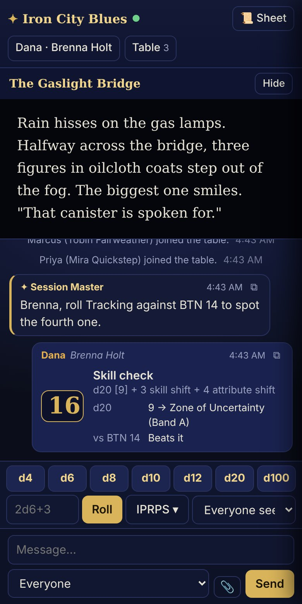

**Privacy at the table.** You see messages sent to everyone and to you. Messages that players send only to other players stay between them. Every roll is made on your computer, so nobody can fake a roll.

> **Tip:** Phones stay silent until the player touches the page once. If you start a sound and someone hasn't, they will see **🔊 Tap to turn on the table sound**.

> **Walkthrough 3: Get your players in**
>
> 1. Choose **Session Master Mode** on the panel. If you have one screen, the Table console opens. If not, open **IPRPS Table** from the Hub.
> 2. Rename the table *Iron City Blues* and choose **Open the table**.
> 3. On a phone on the same Wi-Fi, scan the QR code. Type *Dana* as the name and *Brenna Holt* as the character. Tap **Join the table**.
> 4. Join from a second device as *Priya*, playing *Mira Quickstep*.
> 5. In the console, tick Priya, type *Rooftop* under **Groups**, and choose **Make from selected**.
> 6. Open **Show a text card**. Title: *The Gaslight Bridge*. Text: *Rain hisses on the gas lamps. Three figures in oilcloth coats step out of the fog.* Choose **Show on screens**.
> 7. Tick **Lock**.
>
> **Check:** both devices show the text card at the top. Priya has a **Rooftop** tag under her name. A third device can't join while the table is locked.

## Chapter 5: Roll the IPRPS way

IPRPS uses a d20 for skill checks. The roll has two parts, and IPRPS OS shows both every time.

**The total.** Roll 1d20, then add the **Skill Shift** (the skill divided by 10, rounded down) and the **Attribute Shift** (the attribute minus 10). Compare the total with the **BTN** (Base Target Number) that you set for the task.

**The band.** The d20 by itself also falls in a **band**. **Band A** answers "yes or no?". **Band B** answers "how well?".

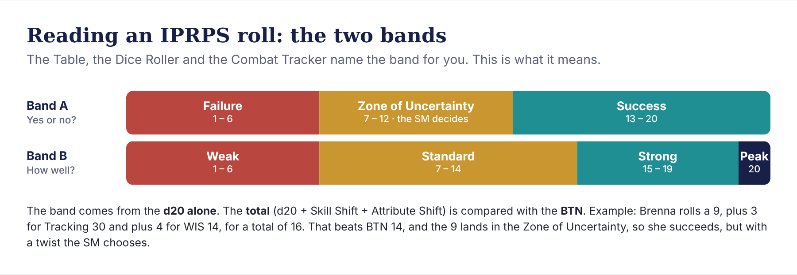

**An example.** Brenna tracks the smugglers. Her player rolls a **9** on the d20. Tracking 30 gives a Skill Shift of **+3**, and WIS 14 gives an Attribute Shift of **+4**. The total is **16**, which beats BTN 14. But the 9 lands in the **Zone of Uncertainty**, so you, the Session Master, decide the twist. Maybe she finds the trail, but the smugglers hear her coming.

You never have to do this math. The Table, the Dice Roller and the Combat Tracker do it, and they name the band for you.

### Three places to roll

**1. On the IPRPS Table.** Players open **IPRPS ▾** on the dice bar and pick a roll: **Skill check**, **Initiative**, **Reaction**, **Trinity Hand**, **Dual-Die attack**, **Infinite Convergence**, **RPS stance**, or a weapon's damage. They type their numbers and roll. They choose who sees it: **Everyone sees**, **Only the SM sees** or **Only I see**.

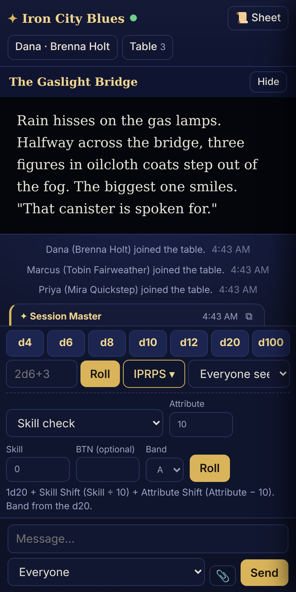

**2. In the Dice Roller on your computer.** It has every die, any dice formula (such as `2d6+3`), and the same IPRPS rolls. Under **After each roll** you choose what happens next: **Add it to the session log**, **Show it on the player display**, **Show it on the IPRPS Table**, or **Secret roll (only you see it)**. The **History** keeps every roll.

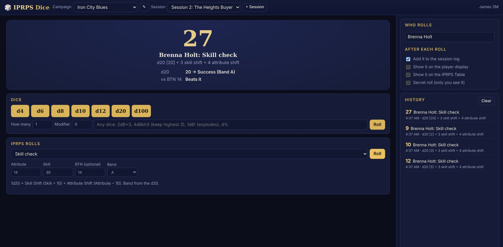

**3. In the Combat Tracker** during fights (Chapter 6), with **Quick roll**.

> **Walkthrough 4: A skill check, start to finish**
>
> 1. With your players at the Table, send everyone a message: *Brenna, roll Tracking against BTN 14.*
> 2. On Dana's phone: **IPRPS ▾ → Skill check**. Attribute **14**, Skill **30**, BTN **14**, Band **A**. Tap **Roll**.
> 3. Read the result in the console's chat. It shows the d20, the shifts, the total, the band, and **Beats it** or **Falls short**.
> 4. Now roll a secret one yourself. In the **Dice Roller**, type *Ostrander* under **Who rolls**, pick **Reaction**, tick **Secret roll (only you see it)**, and roll.
> 5. Untick **Secret roll** and tick **Add it to the session log**. Roll a Skill check for Brenna.
>
> **Check:** the players saw Brenna's roll but not Ostrander's reaction. The Session Log (Chapter 9) shows Brenna's second roll.

## Chapter 6: Run a fight

The **Initiative and Combat Tracker** keeps a fight moving. It tracks turn order, rounds, HP, Armor Rating and conditions for every fighter. Fights are saved by session, so you can stop and pick up later.

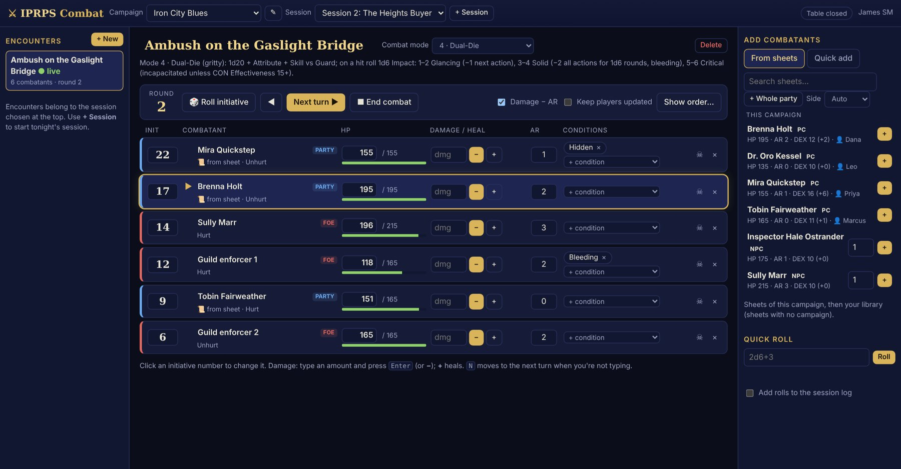

### The five IPRPS combat modes

Pick the mode in the **Combat mode** menu. The tracker shows a short reminder of how that mode works.

| Mode | Best for | In one line |
| --- | --- | --- |
| **1 · Standard** | Most fights | Initiative 1d20 + DEX modifier. Attack 1d20 + Skill Shift + Attribute Shift against Guard. Damage − AR |
| **2 · Trinity Hand** | Bosses, hordes, player-versus-player | Everyone rolls 1d3 Velocity, 1d20 Impact and 1d12 Guard at once. Bosses roll extra Impact dice (Hydra Hand) |
| **3 · Rock-Paper-Scissors** | Quick story skirmishes | Rock beats Scissors, Scissors beats Paper, Paper beats Rock |
| **4 · Dual-Die** | Gritty, dangerous fights | On a hit, roll 1d6 Impact: Glancing, Solid or Critical wounds |
| **5 · Infinite Convergence** | One big, decisive clash | Each fighter picks a Blur level: more dice for speed, or bigger dice for precision. Top results explode |

### The main controls

| Control | What it does |
| --- | --- |
| **+ New** | Makes a new encounter in tonight's session |
| **From sheets** | Adds characters from Character Sheets. **+ Whole party** adds every player character at once |
| **Quick add** | Adds fighters by hand: name, how many, HP, AR and initiative modifier |
| **🎲 Roll initiative** | Rolls for every fighter who doesn't have a number yet |
| **▶ Start combat** / **Next turn ▶** | Starts the fight and moves to the next fighter. The **N** key does the same |
| Damage box | Type the damage and press **Enter**. With **Damage − AR** ticked, the tracker subtracts the target's AR for you. **+** heals |
| **+ condition** | Adds a condition such as *Bleeding* or *Hidden* |
| **Keep players updated** | Shows the turn order to players after each turn |
| **■ End combat** | Ends the fight and records it in the session log |

> **Walkthrough 5: Ambush on the Gaslight Bridge**
>
> The smugglers spring a trap on the party in the rain. Use Dual-Die, the gritty mode.
>
> 1. Open the **Combat Tracker**. Set **Campaign** to *Iron City Blues*. Choose **+ Session** to start tonight's session.
> 2. Under **Encounters**, choose **+ New**. Name it *Ambush on the Gaslight Bridge*. Set **Combat mode** to **4 · Dual-Die**.
> 3. Under **Add combatants → From sheets**, choose **+ Whole party**. Your player characters join with their HP and AR.
> 4. Choose **Quick add**. Name *Guild enforcer*, **How many** 2, **HP** 165, **AR** 2, **Side** Foe. Choose **+ Add**. Add *Sully Marr*, HP 215, AR 3, the same way.
> 5. Choose **🎲 Roll initiative**, then **▶ Start combat**.
> 6. Mira hits an enforcer for 12. Type **12** in his damage box and press **Enter**. His HP drops by **10**, because his AR of 2 is taken off.
> 7. The hit was a Solid wound. Choose **+ condition** and add **Bleeding**.
> 8. Press **N** to move to the next fighter. Tick **Keep players updated** so the players see whose turn it is.
> 9. When Sully flees, choose **■ End combat**.
>
> **Check:** the fight shows the round number and each fighter's HP bar. The Session Log has a combat entry for the ambush.

> **Tip:** Click any initiative number to change it, for example when a player delays their turn.

## Chapter 7: Set the mood

Sound turns a description into a scene. IPRPS OS gives you three ways to play it.

| Sound | Where it plays | How |
| --- | --- | --- |
| **Ambience playlist** | Your computer's speakers | Session Master Mode plays your **Campaigns/Audio** folder |
| **Soundboard pads** | Your speakers, and players' devices if you choose | Click a pad, or press its key |
| **Table sound** | Players' phones and laptops | **♪ Play** in the Table console |

### The Soundboard

The **Soundboard** puts sounds on big buttons called **pads**. The built-in sounds are made by the computer as they play, so they need no files and no internet.

- **∞ pads loop** until you click them again: rain, storm, wind, campfire, ocean, river, cave drips, night crickets, a dungeon drone and a tavern hum. Several can play together.
- **Effect pads** play once: thunder, a sword clash, an arrow, a spell, a gong, a war horn, level up and more.
- **Keys 1–0 and Q–P** play the first twenty pads. **Esc** fades everything out.

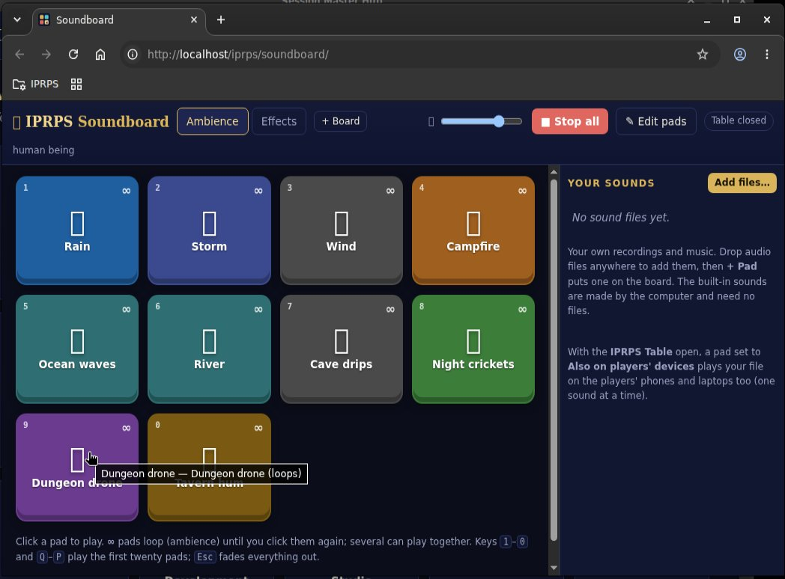

Add your own music and recordings with **Add files…**, or drop them on the window. Choose **+ Pad** to put one on a board. Make a new board, such as *Tavern* or *Battle*, with **+ Board**. To change a pad, choose **✎ Edit pads** and click it. A pad set to **Also on players' devices** plays your file on the players' phones too, while the Table is open.

> **Try it:** Make a board called *Iron City*. Put **Rain** and **Tavern hum** on it, plus **Thunder** as an effect. Start the rain, then press the thunder pad's key during the ambush.

## Chapter 8: Ask the IPRPS Oracle (Medium and Advanced)

Players often go somewhere you didn't plan. The **IPRPS Oracle** helps you keep up. It is a storyteller AI. Its model, **Llama 3.2 3B**, runs **entirely on your computer**. It needs no internet, no account and no API key, and nothing you type leaves the machine. *Built with Llama.*

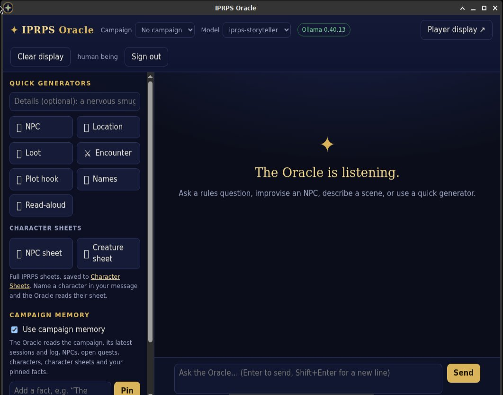

**What it can do:**

- **Quick generators:** **NPC**, **Location**, **Loot**, **Encounter**, **Plot hook**, **Names** and **Read-aloud**. Type a few words, such as *a nervous dockhand*, then choose a generator.
- **Character sheets:** **NPC sheet** and **Creature sheet** write complete IPRPS sheets and save them to Character Sheets.
- **Campaign memory:** it reads your campaign, its latest sessions and log, NPCs, open quests and character sheets. **Pin** facts it must always respect.
- **Share it:** under each answer, **Show players** puts it on the player display, **Pin to memory** saves it as a fact, and **Save NPC** keeps a character for later.

**Good habits:**

- Set the **Campaign** menu at the top before you ask, so the Oracle knows your story.
- Pin the facts that matter, like who is secretly working for whom.
- Treat answers as ideas. You are the Session Master, so change anything you like.
- The first answer of the day is slower while the AI loads. Session Master Mode warms it up for you.
- On an older computer, a long answer can take a minute or more. **Clear this chat** between scenes, and untick **Use campaign memory** for **Names** and **Loot**. Both make answers start sooner.

> **Walkthrough 6: When the players go off script**
>
> Tobin decides to visit a pawnshop you never planned.
>
> 1. Open the **IPRPS Oracle**. Set **Campaign** to *Iron City Blues*.
> 2. Under **Campaign memory**, type *The Harbor Guild pays the Night Watch to look away on Thursdays.* Choose **Pin**.
> 3. In the **Details** box above the generators, type *a pawnbroker near the docks who hears everything*. Choose **NPC**.
> 4. Read the answer. If you like the character, choose **Save NPC**.
> 5. In the **Details** box, type *the pawnshop at night, in the rain* and choose **Read-aloud**. Choose **Show players** to put it on the player display, or copy it into a Table text card.
> 6. Need stats in a hurry? Type a short description of the pawnbroker in **Details** and choose **NPC sheet**. It takes a minute or two with the local model.
>
> **Check:** the new sheet appears in Character Sheets under **NPCs**, ready to add to a fight.

### Optional: Claude, the online AI

The local model is free and private, but it can be slow on older computers. If you have internet, the Oracle can use **Claude**, an AI made by Anthropic, instead. Claude usually answers in seconds and writes richer scenes. You need your own **Anthropic API key**, and Anthropic charges your account a small amount for each answer.

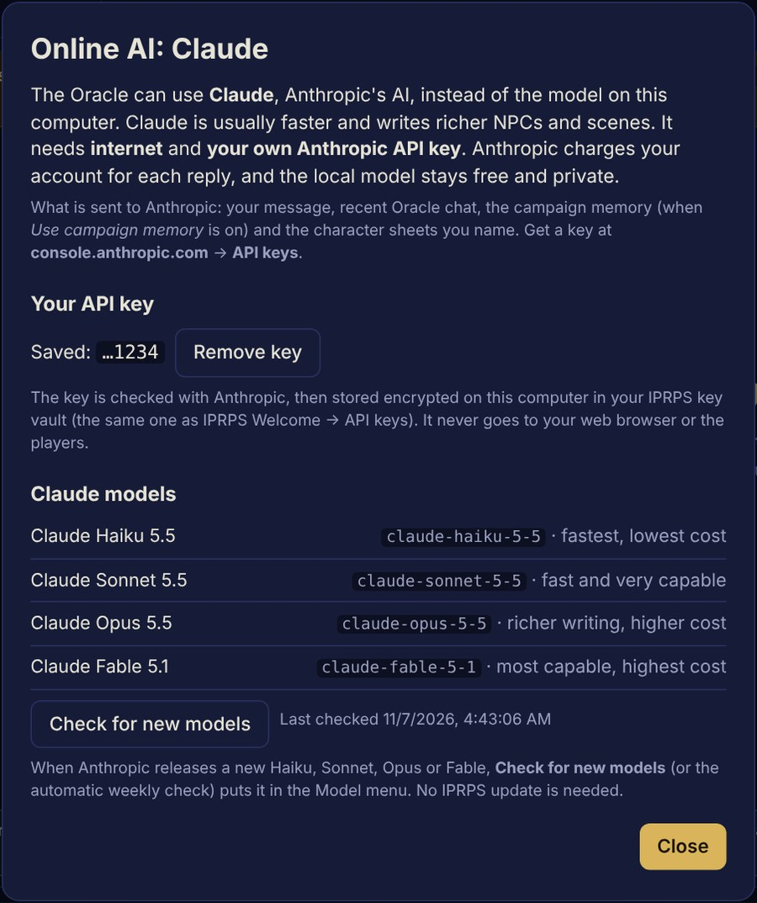

**Set it up once:**

1. Get a key at **console.anthropic.com**, under **API keys**. It starts with `sk-ant-`.
2. In the Oracle, choose **Online AI…** next to the **Model** menu.
3. Paste the key and choose **Check and save**. The Oracle tests the key first. Then it stores it, locked with encryption, on your computer.

**Choose a model** in the **Model** menu, under *Online: Claude*:

| Model | Good for |
| --- | --- |
| **Claude Haiku** | The fastest and cheapest. Quick NPCs and names at the table |
| **Claude Sonnet** | Fast and very capable. A good everyday choice |
| **Claude Opus** | Richer writing, at a higher cost. Prep work between sessions |
| **Claude Fable** | Anthropic's most capable model, at the highest cost |

**What changes when Claude is on:**

- The top bar turns teal and says **Online**. A notice above the message box reminds you that your message, the campaign memory and any character sheets you name go to Anthropic.
- Recaps (**✦ Draft with the Oracle**) and **NPC sheet** use Claude too.
- To go back, choose **iprps-storyteller** under *On this computer*. **Remove key** deletes your key.

**New Claude models.** When Anthropic releases a new model, choose **Check for new models** in **Online AI…**. The Oracle also checks once a week by itself. The new model shows up in the menu. You don't need an IPRPS update.

> **Tip:** Use the local model when your campaign holds secrets you'd rather keep at home. Use Claude when speed matters most, like a busy game night.

## Chapter 9: Wrap up the night

The **Session Log and Recap** keeps a record of every game night. Notes, events, rolls, fights, loot and XP go in as you play. The Dice Roller, the Combat Tracker and the Oracle add their own entries, so your log fills up by itself.

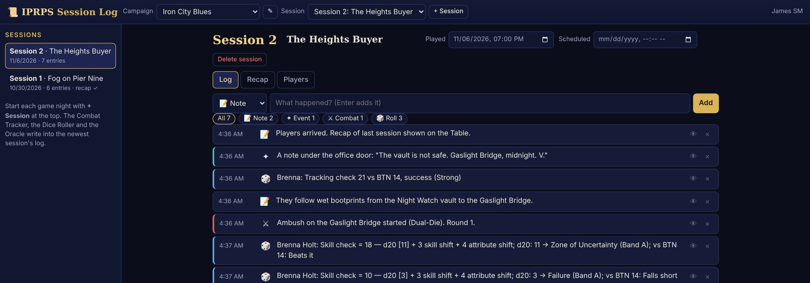

### During the game

Start each game night with **+ Session** at the top. Then add your own entries as you go. Pick the type (**📝 Note**, **✦ Event**, **⚔ Combat**, **🎲 Roll**, **💰 Loot** or **⭐ XP**), type what happened, and press **Enter**.

### After the game

Open the **Recap** tab:

- **Draft from the log** writes a first draft of the recap from tonight's entries. In Medium and Advanced, **✦ Draft with the Oracle** writes it as a short story instead.
- Edit the draft. It's for the players, so keep secrets out of it.
- Put your secrets in **Session Master notes**. Players never see them, but the Oracle reads them.
- **Copy**, **Download .md** and **Print** let you share the recap outside IPRPS OS.

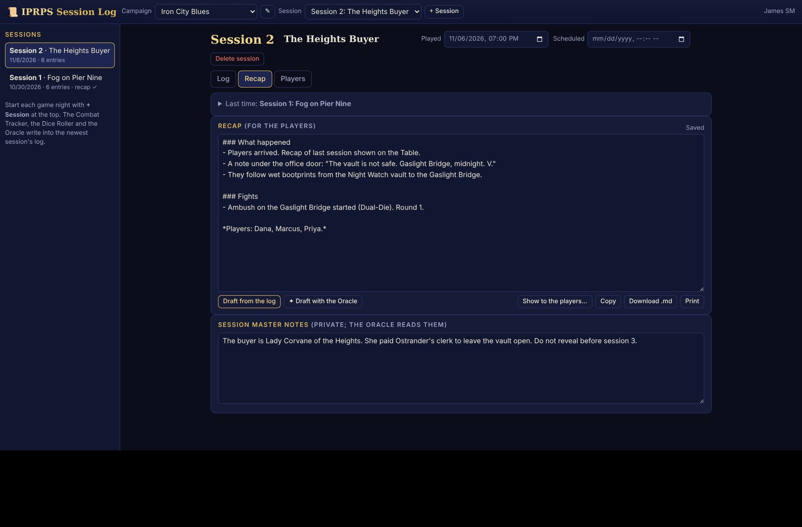

Use the **Players** tab to record who came and the XP each player earned. XP here is a record. Update each character's XP on their sheet too.

> **Walkthrough 7: Close out the night**
>
> 1. In the **Session Log**, check that tonight's session is selected. Add a **💰 Loot** entry: *A brass key from Sully's coat.*
> 2. Open the **Recap** tab and choose **Draft from the log**. Shorten it to a few sentences.
> 3. In **Session Master notes**, type the secret: *The buyer is Lady Corvane of the Heights.*
> 4. Open the **Players** tab. Mark who played, and enter the XP you awarded.
> 5. In the Table console, choose **Close the table**. Everyone is disconnected, but the chat and media are kept for next time.
> 6. Next game night, start the new session with **+ Session**. On its **Recap** tab, open **Last time** and choose **Show “last time” to the players…** to begin with last session's recap.
>
> **Check:** the session list on the left shows "recap ✓" next to tonight's session.

## Chapter 10: Keep it running

### IPRPS Updates

IPRPS OS updates itself without reinstalling. About 10 minutes after you start the computer, and every 6 hours while you're online, it checks for updates. When some are ready, a notice appears on the desktop and on the Hub's **IPRPS Updates** tile.

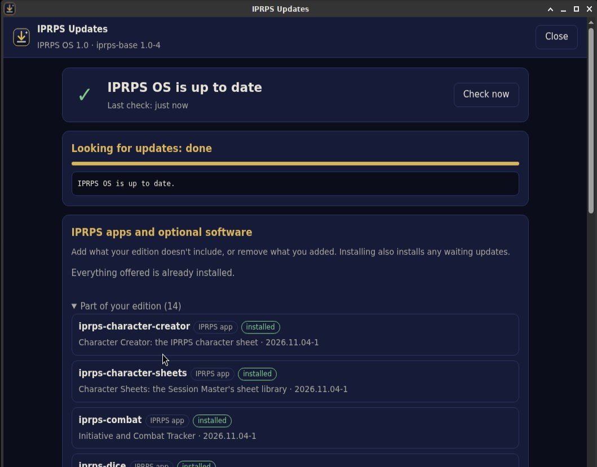

To install them, open **IPRPS → IPRPS Updates**, type your password, and choose **Install updates**. Your campaigns, sheets, settings and files are kept. The same window lists extra IPRPS apps and optional software you can add with **Install**.

> **Tip:** Install updates the day before game night, not an hour before.

### Remote players

A friend who moved away can still join your IPRPS Table. Both computers install **Tailscale**, a free app that links them over the internet with strong encryption. Your friend then joins exactly like a player on your Wi-Fi, at an address your Table console lists. IPRPS OS itself doesn't change.

In short:

1. On your computer, run the `iprps-remote-play.sh` script from the IPRPS OS repository, and sign in to Tailscale.
2. In Tailscale's admin page, **share** your IPRPS computer with your friend, and add the rule that lets players reach only the Table.
3. Your friend installs the Tailscale app, accepts your invite, and opens the `http://100.x.y.z:7777/` address with the join code.

Full steps are in `docs/REMOTE-PLAYERS.md` and in Appendix G of the build guide. Test it with a phone on mobile data first. Pictures and video you show come from your home internet's upload speed, so short clips work best.

## Quick reference: game night

| Moment | Tool | Where |
| --- | --- | --- |
| Open everything for game night | Session Master Mode | Panel at the top of the screen |
| Let players in | **Open the table**, then **Lock** | Table console, top |
| Show a map or handout | **Push to screens → Add media… → Show** | Table console, right |
| Read a scene aloud | **Show a text card → Show on screens** | Table console, right |
| Music on players' devices | **♪ Play**, **Loop**, **■ Stop sound** | Table console, right |
| Whisper to one player | **To** menu → their name | Table console, message box |
| Talk to a split party | **Make from selected**, then **To** → the group | Table console, left |
| Secret roll | **Secret (only me)**, or **Secret roll** in the Dice Roller | Dice bar / Dice Roller |
| An IPRPS check | **IPRPS ▾ → Skill check** | Dice bar on any device |
| Start a fight | **+ New**, **+ Whole party**, **Roll initiative** | Combat Tracker |
| Next turn | **Next turn ▶** or the **N** key | Combat Tracker |
| Thunder! | Click the pad, or press its key | Soundboard |
| A quick NPC or place | **NPC**, **Location** | IPRPS Oracle (Medium and up) |
| A faster Oracle | **Model** menu → a Claude model (online, your key) | IPRPS Oracle, **Online AI…** |
| End of the night | **Draft from the log**, then **Close the table** | Session Log, Table console |

## Troubleshooting at the table

| Problem | What to do |
| --- | --- |
| A player can't open the Table address | Their device must be on the **same Wi-Fi** as your computer. Guest Wi-Fi networks often block devices from seeing each other, so use your main network. Check that the table says **Open** |
| "The table is closed" | Choose **Open the table** in the console. After a restart, the table always starts closed |
| A player can't join | You may have ticked **Lock**. Untick it, let them in, then lock again |
| A phone plays no sound | The player must tap the page once. Look for **🔊 Tap to turn on the table sound** |
| Someone saw the join code who shouldn't have | Choose **New code**. Players already at the table stay connected |
| The Combat Tracker says to choose a session | Choose **+ Session** at the top to start tonight's session |
| A character isn't in the **From sheets** list | Import their sheet into Character Sheets, and set its campaign to this one |
| The Oracle is slow | The first answer of the day takes longest, so start Session Master Mode early. **Clear this chat** between scenes. The local model needs a fairly recent processor and plenty of memory (16 GB is best). For answers in seconds, choose a Claude model (Chapter 8) |
| The Oracle says *A new local model is ready* | An update brought a new local model. Open a terminal and type `sudo iprps-ai-model upgrade` once (it downloads 3.4 GB). The old model keeps working until then |
| Claude: *refused the API key*, or *out of credit* | Copy the key again from console.anthropic.com, or add credit to your Anthropic account. The local model always works |
| The players see an old picture | Choose **Clear screens**, then show the new one |

## Glossary

| Term | Meaning |
| --- | --- |
| **AR (Armor Rating)** | Armor's protection. It is subtracted from damage: Damage − AR |
| **Band A / Band B** | How to read the d20. Band A: Failure, Zone of Uncertainty, Success. Band B: Weak, Standard, Strong, Peak |
| **BTN (Base Target Number)** | The number a check's total must reach |
| **Campaign** | Your whole story. Sessions, sheets, fights and notes belong to it |
| **Console** | The Session Master's screen of the IPRPS Table |
| **Development Points (DP)** | The points players spend to build characters |
| **IPRPS** | The Infinite Plane Role Playing System, by Mythical Legends Publishing |
| **IPRPS Oracle** | The storyteller AI (Medium and Advanced). Llama 3.2 runs on your computer; Claude is an optional online choice |
| **API key** | A secret code from a company like Anthropic that lets an app use its online AI and charges your account |
| **IPRPS Table** | Lets players join from their own devices to chat, roll and see what you share |
| **Join code** | The six-character code players type to join an open table |
| **Player display** | A full-screen window for players on a second screen |
| **Session** | One game night. Its log, fights and recap belong to it |
| **Session Master (SM)** | The person who runs the game |
| **Session Master Mode** | One click that opens the Hub, ambience and the players' screen |
| **Skill Shift / Attribute Shift** | What a check adds to the d20: skill ÷ 10, and attribute − 10 |
| **Zone of Uncertainty** | A d20 of 7 to 12 in Band A. The SM decides what happens, often success with a cost |

---

*IPRPS OS and the Infinite Plane Role Playing System are by Mythical Legends Publishing, LLC (infiniteplane.space). The IPRPS Oracle's local model is Built with Llama: Llama 3.2 is licensed under the Llama 3.2 Community License, Copyright © Meta Platforms, Inc. All Rights Reserved. Claude is a product of Anthropic. Screenshots show IPRPS OS 1.0 with example data. Roll20, Owlbear Rodeo, Alchemy RPG, Fantasy Grounds and D&D Beyond are trademarks of their owners and are named only for comparison. Their features and prices change; check their websites for current details.*
